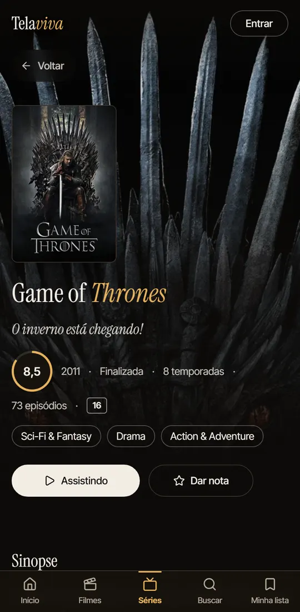
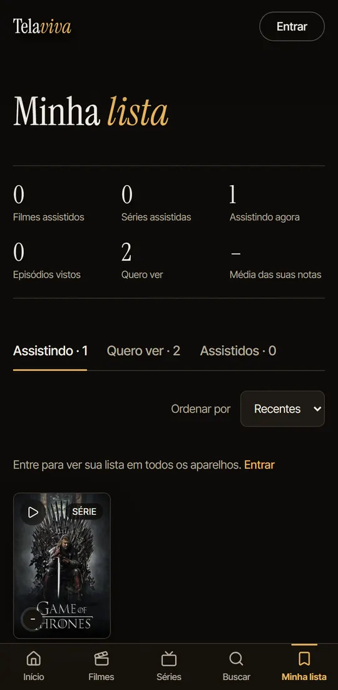
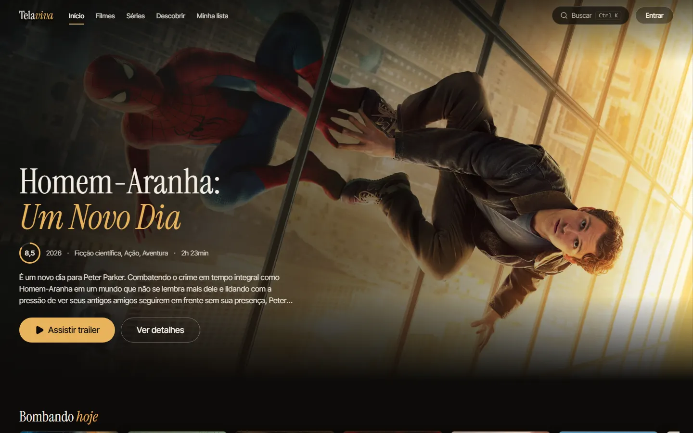
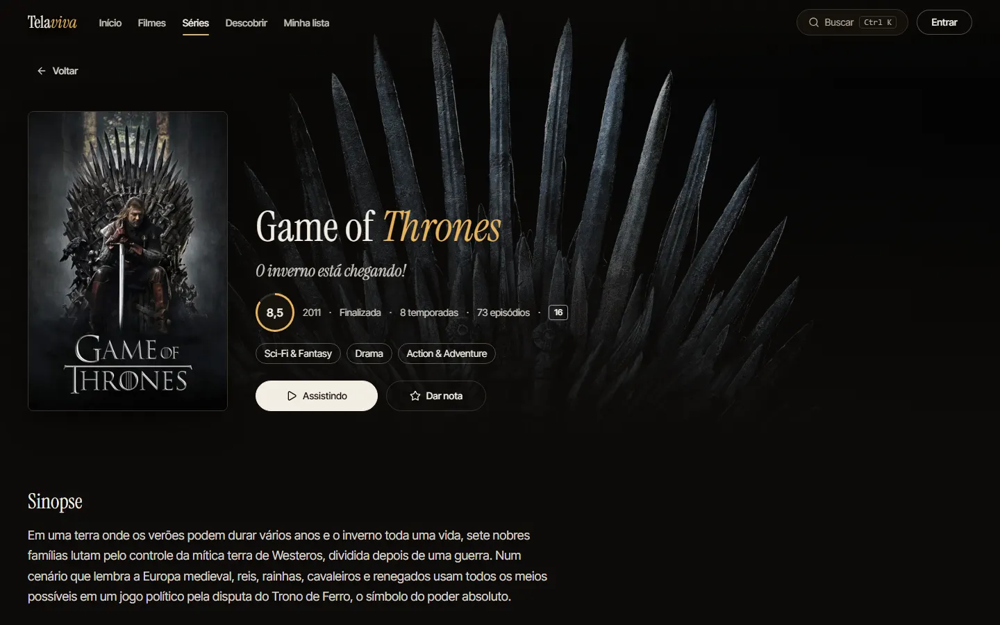
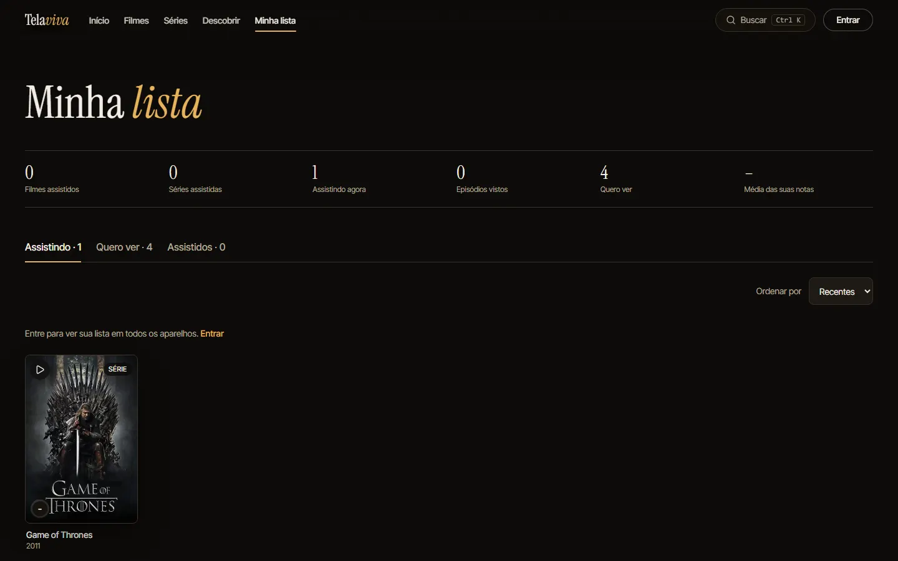
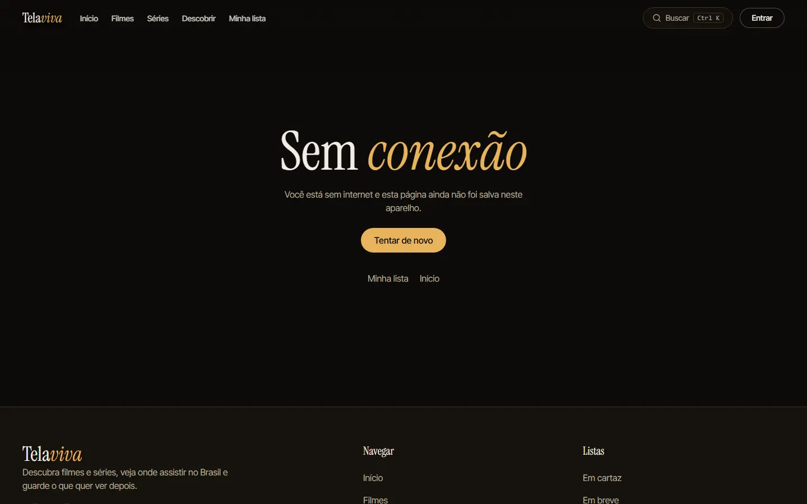

# TelaViva

Filmes e séries em português, com onde assistir no Brasil, acompanhamento de séries episódio por episódio e uma lista
que funciona sem internet. No ar em **[telaviva.vercel.app](https://telaviva.vercel.app)**.

O projeto tem dois públicos: amigos que usam o site todo dia, quase sempre no celular, e quem chega aqui pelo
portfólio. A v2 é uma reescrita completa da versão original (React 18 com CRA), que continua marcada na tag `v1`.

<p>
  
  
  
  
</p>



<details>
<summary>Mais capturas no desktop</summary>





</details>

## Recursos

- **Catálogo de filmes e séries:** destaque editorial, trilhos sem títulos repetidos, listas (em cartaz, no ar hoje,
  mais bem avaliados), gêneros, pessoas e Descobrir com filtros na URL.
- **Detalhe completo:** trailer, elenco, onde assistir no Brasil (streaming, aluguel e compra), classificação e
  recomendados.
- **Acompanhamento de séries:** marcar episódio, temporada ou "até aqui"; próximo episódio, "em dia" e data do próximo
  lançamento.
- **Minha lista:** Assistindo, Quero ver e Assistidos, nota pessoal de 1 a 10, estatísticas e recomendações a partir do
  que você avaliou.
- **Busca unificada** de filmes, séries e pessoas, com paleta rápida (Ctrl+K) no desktop.
- **Login opcional** com Google ou e-mail e senha. Quem não entra usa tudo como visitante, com a lista no navegador; no
  primeiro login ela é mesclada na conta e passa a sincronizar entre aparelhos. Exportar dados e excluir a conta (LGPD).
- **Offline:** o app instalado abre sem internet, a Minha lista e as páginas visitadas continuam disponíveis, e as ações
  feitas offline sincronizam quando a conexão volta.
- **PWA instalável**, prévia rica ao compartilhar links (imagem gerada por título) e identidade visual própria,
  "Sala Escura", com suporte a `prefers-reduced-motion`.

## Stack

| Área            | Tecnologia                                                                            |
| --------------- | ------------------------------------------------------------------------------------- |
| App             | Next.js 16.4 (App Router, Cache Components, React Compiler), React 19.3, TypeScript 6 |
| Estilo          | Tailwind CSS 4.3 (tokens só no `@theme`), lucide-react                                |
| Dados no client | TanStack Query 5, Zod 4                                                               |
| Contas          | Firebase Auth 13 no navegador, firebase-admin 13 no servidor (cookie de sessão)       |
| Banco           | Postgres no Neon, Drizzle ORM 0.45 com migrações versionadas                          |
| Offline         | Serwist 9.5 (service worker), IndexedDB com `idb` 8                                   |
| Testes          | Vitest 5, Testing Library, MSW 3, PGlite, Playwright 1.65, axe-core                   |
| Infra           | Vercel (região `gru1`), GitHub Actions, Dependabot; Node 24                           |

Todas as dependências de runtime ficam em versões fixadas. O TMDb é chamado só pelo servidor, com o token Bearer; as
imagens vêm direto do CDN do TMDb.

## Arquitetura

- **Por domínio.** O código fica em `src/features/<domínio>` (`catalog`, `detail`, `library`, `auth`, `offline`,
  `search`, `tmdb`, `share`, `shell`...), com o servidor em `src/server` (sessão, banco, biblioteca), componentes de
  interface em `src/ui` e o service worker em `src/sw`. As rotas em `src/app` são finas e em pt-BR (`/serie/[id]-[slug]`,
  `/minha-lista`).
- **Biblioteca com dois repositórios e um redutor.** Toda ação (status, nota, episódio, remover) é um comando aplicado
  por um redutor puro (`src/features/library/commands.ts`). O visitante usa o repositório local (localStorage); quem tem
  conta usa o repositório do servidor, que aplica o mesmo comando no Postgres. A interface é otimista e oferece desfazer.
- **Offline sem desfazer nada mais novo.** Um repositório offline envolve o do servidor: sem rede, ele aplica o comando
  sobre a última cópia guardada no IndexedDB (por conta) e o põe numa fila. Cada comando leva o horário em que foi feito
  no aparelho. No servidor, uma linha só é sobrescrita por uma escrita mais nova, e **marcas de remoção** impedem que uma
  escrita atrasada recrie algo removido depois em outro aparelho. Comandos repetidos são ignorados pelo id.
- **Service worker com regras próprias.** Guarda os arquivos do build, as páginas visitadas, o catálogo público e as
  imagens do TMDb. Nada pessoal: `/api/library`, `/api/account`, `/api/auth` e o login passam sempre direto. Cada deploy
  troca o cache de forma limpa, e um botão de emergência (`NEXT_PUBLIC_SW_DISABLED=1`) remove o worker.
- **Sessão por cookie.** O navegador entra com o Firebase, e o servidor troca o token por um cookie de sessão httpOnly
  (firebase-admin). Assim as páginas renderizadas no servidor sabem quem é o usuário. O login do Google passa por um
  proxy `/__/auth` no próprio domínio, o que funciona no Safari/iOS e no app instalado sem cookies de terceiros.
- **Segurança.** CSP em lista de permissões e cabeçalhos (`nosniff`, `Referrer-Policy`, `Permissions-Policy`,
  `X-Frame-Options`) em `src/lib/security-headers.ts`; rotas de escrita conferem a origem; entradas validadas com Zod.
  Detalhes em [docs/audits/2026-11-fase4-seguranca-a11y.md](docs/audits/2026-11-fase4-seguranca-a11y.md).
- **Login desligável.** Sem as variáveis do Firebase e do banco, o site funciona inteiro como visitante.

## Como rodar

Pré-requisitos: Node 24 e um token de leitura do TMDb (gratuito).

```bash
git clone https://github.com/higorxyz/telaviva.git
cd telaviva
npm install
cp .env.example .env.local   # preencha ao menos TMDB_READ_TOKEN
npm run env:check            # lista o que falta, só pelos nomes
npm run dev                  # http://localhost:3000
```

Só o `TMDB_READ_TOKEN` é obrigatório. As variáveis do Firebase e do Neon ligam o login; o
[guia de configuração](docs/setup/configuracao.md) explica cada uma, inclusive produção na Vercel.

Para desenvolver o login sem as contas reais, use o emulador do Firebase Auth (`npm run emulators`, porta 9099) e o
PGlite no lugar do Neon (`DATABASE_DRIVER=pglite`); o passo a passo está na
[seção 5.1 do guia](docs/setup/configuracao.md#51-sem-as-contas-reais-emulador-e-pglite).

| Comando                           | O que faz                                                                    |
| --------------------------------- | ---------------------------------------------------------------------------- |
| `npm run dev`                     | servidor de desenvolvimento (sem service worker)                             |
| `npm run build` / `npm run start` | build de produção e servidor dele                                            |
| `npm run env:check`               | confere as variáveis (`-- --target=local\|preview\|production`), sem valores |
| `npm run lint`                    | ESLint, sem avisos                                                           |
| `npm run typecheck`               | TypeScript do app e do service worker                                        |
| `npm test`                        | testes de unidade e componentes (Vitest)                                     |
| `npm run e2e`                     | build de produção + testes de ponta a ponta (Playwright)                     |
| `npm run check`                   | lint, typecheck, testes e build em sequência                                 |
| `npm run db:migrate`              | aplica as migrações (`-- --confirm` para o Neon)                             |
| `npm run emulators`               | emulador do Firebase Auth                                                    |

## Testes e CI

- **Unidade e componentes** (`npm test`): Vitest com Testing Library e MSW simulando o TMDb. As regras de domínio
  (progresso de séries, nota, mesclagem visitante/conta, fila offline, marcas de remoção) rodam contra um Postgres real
  em memória, o **PGlite**.
- **Ponta a ponta** (`npm run e2e`): Playwright no desktop (1440×900) e no celular (Pixel 7), sobre o build de
  produção. O comando sobe sozinho o emulador do Firebase Auth, um mock do TMDb e um PGlite em disco; nenhuma conta real
  é usada. Inclui axe (WCAG A/AA), navegação por teclado, modo offline com o service worker, login com mesclagem e os
  cabeçalhos de segurança.
- **CI** (GitHub Actions, `.github/workflows/ci.yml`): em todo push e PR, o job `Lint, Typecheck, Test, Build and E2E`
  roda lint, typecheck, testes e o E2E. O Dependabot atualiza npm e Actions toda semana.

Guias: [fluxo de PR](docs/contributing/pull-request-workflow.md), [triagem de issues](docs/contributing/issue-triage.md)
e [proteção da `main`](docs/maintenance/branch-protection.md).

## Créditos

Powered by [TMDB API](https://www.themoviedb.org/) & [JustWatch](https://www.justwatch.com/br).

Dados de filmes, séries e pessoas vêm do TMDb; os dados de onde assistir vêm da JustWatch, via TMDb.
_This product uses the TMDB API but is not endorsed or certified by TMDB._

## Licença

[MIT](LICENSE) © Higor Batista · [GitHub](https://github.com/higorxyz) ·
[LinkedIn](https://www.linkedin.com/in/higorbatista)
